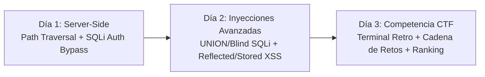

# 🛡️ Laboratorio de Seguridad en Aplicaciones Web — UNSL (Purple Team)

Plataforma integral y autocontenida de entrenamiento en ciberseguridad web, desarrollada para el **Taller de Seguridad Web (3 Jornadas · 9 horas)** de la **Escuela de Informática de la Universidad Nacional de San Luis (UNSL)**.

El entorno está diseñado para funcionar de forma **100% offline** en la Sala de Máquinas Linux de la facultad, garantizando aislamiento entre alumnos, control pedagógico para el cuerpo docente y una experiencia inmersiva estilo *hacker terminal* para la competencia final.

---

## 📌 Tabla de Contenidos
1. [Características Principales](#-características-principales)
2. [Credenciales y Accesos por Defecto](#-credenciales-y-accesos-por-defecto)
3. [Estructura del Taller (3 Jornadas)](#-estructura-del-taller-3-jornadas)
4. [Terminal Retro CTF (`/ctf.html`)](#-terminal-retro-ctf-ctfhtml)
5. [Panel de Control Docente](#-panel-de-control-docente)
6. [Aislamiento y Seguridad Multi-Estudiante](#-aislamiento-y-seguridad-multi-estudiante)
7. [Instalación y Puesta en Marcha](#-instalación-y-puesta-en-marcha)
8. [Mapa de Endpoints de la API](#-mapa-de-endpoints-de-la-api)
9. [Estructura del Repositorio](#-estructura-del-repositorio)
10. [Pruebas Automatizadas y Verificación](#-pruebas-automatizadas-y-verificación)

---

## 🚀 Características Principales

- **Doble Interfaz de Usuario**:
  - **Portal SIU Guaraní (`/index.html`)**: Simulación del sistema de gestión académica universitario con vulnerabilidades web reales (*Path Traversal, SQL Injection, Cross-Site Scripting*), visualizador de código vulnerable vs. remediado, y cuestionarios interactivos.
  - **Terminal Retro Hacker CTF (`/ctf.html`)**: Terminal inspirada en interfaces CRT y ASCII Art en tiempo real (*Donut 3D, Radar táctico, Analizador de ondas, Matrix rain*), con retos encadenados progresivos y ranking en vivo.
- **Aislamiento Multi-Estudiante**: Previene que las acciones de un estudiante interfieran con los demás mediante usuarios de base de datos de solo lectura, timeouts estrictos, sandboxing de archivos y rate limiting por IP.
- **Control Pedagógico Docente**: Bloqueo/desbloqueo de módulos por jornada, bloqueo estricto de la CTF hasta su liberación oficial, modo demostración en vivo y exportación de calificaciones en CSV.
- **100% Offline & Autocontenido**: Base de datos en memoria H2 pre-poblada, sin dependencias externas de CDNs o APIs de terceros en tiempo de ejecución.

---

## 🔑 Credenciales y Accesos por Defecto

| Rol / Sistema | Usuario | Contraseña | Descripción / Uso |
| :--- | :--- | :--- | :--- |
| **Panel Docente** | — | `unsl-docente-2026` | Control de fases, desbloqueo de CTF, modo demo y exportación CSV. Configurable con `DOCENTE_PASSWORD`. |
| **Tutor / Ayuda** | — | `unsl-tutor-2026` | Acceso a pistas pedagógicas y remediaciones seguras. Configurable con `HELP_PASSWORD`. |
| **Admin SIU Guaraní** | `admin` | `AdminSecret2026!` | Cuenta de superadministrador en la base de datos `users`. |
| **Docente SIU** | `mperez` | `ProfeSecure#2026` | Cuenta con rol `PROFESSOR`. |
| **Estudiante SIU** | `agomez` | `AlumnoPass123` | Cuenta estándar de alumno (`STUDENT`). |
| **Estudiante SIU** | `jmartinez` | `clave456` | Cuenta estándar de alumno (`STUDENT`). |

---

## 📅 Estructura del Taller (3 Jornadas)

El laboratorio organiza el aprendizaje en una metodología **Purple Team** (Red Team para explotación ética y Blue Team para análisis y remediación segura de código):



### 🔹 Día 1: Server-Side & Fundamentos
- **CWE-22: Path Traversal (Validador de Certificados)**:
  - Explotación de lectura arbitraria mediante secuencias `../` y escapes de ruta.
  - Extracción de metadatos confidenciales en `storage/confidential/flag.txt`.
  - Remediación segura en `FileController.java` usando `Path.normalize()` y validación estricta de prefijo con `startsWith()`.
  - Cuestionario formativo interactivo sobre canonicidad de rutas.
- **CWE-89: SQL Injection — Parte 1 (Bypass de Autenticación)**:
  - Identificación de concatenación directa de parámetros en sentencias SQL.
  - Bypass del formulario de inicio de sesión con payload booleano (`' OR '1'='1`).
  - Cuestionario sobre AST de bases de datos y principios de `PreparedStatement`.

### 🔹 Día 2: Inyecciones Avanzadas y Client-Side
- **CWE-89: SQL Injection — Parte 2 (UNION-Based & Blind SQLi)**:
  - Extracción de esquemas y credenciales ocultas en la tabla secundaria `audit_secrets` mediante `UNION SELECT`.
  - Inferencia booleana caracter por caracter en el endpoint silencioso `/api/users/check?username=...`.
  - Remediación completa con consultas parametrizadas en `UserController.java`.
- **CWE-79: Cross-Site Scripting (Reflected & Stored XSS)**:
  - Explotación de XSS Reflejado en `/api/profile/greet?name=...` simulando robo de sesión.
  - Explotación de XSS Almacenado persistente en el tablón de notas del estudiante (`/api/profile/notes`).
  - Remediación mediante sanitización y codificación contextual con OWASP Java Encoder (`Encode.forHtml()`).
  - Configuración y análisis de directivas `Content-Security-Policy` (CSP).

### 🔹 Día 3: Competencia CTF Purple Team
- Desafío final cronometrado donde los estudiantes aplican de forma integral las técnicas aprendidas para obtener las 6 flags del sistema.

---

## 💻 Terminal Retro CTF (`/ctf.html`)

Para la jornada final de competencia, los estudiantes acceden a una interfaz temática de terminal inspirada en sistemas retro y **ASCII Magic**:

```text
  ___ ___  ___   ___ ___ ___ _____ _   _    __  __   _   _  _ _   _  _   _    
 | __/ __|/ _ \ / __|_ _| __|_   _| | | |  |  \/  | /_\ | \| | | | |/_\ | |   
 | _|\__ \ (_) | (__ | || _|  | | \   /   | |\/| |/ _ \| .` | |_| / _ \| |__ 
 |_| |___/\___/ \___|___|___| |_|  |_|    |_|  |_/_/ \_\_|\_|\___/_/ \_\____|
```

- **Efectos Visuales ASCII en Tiempo Real**:
  - **Donut 3D**: Renderizado matemático en canvas ASCII rotando en los ejes X y Z.
  - **Radar Táctico**: Escaneo circular continuo con barrido de objetivos dinámicos.
  - **Analizador de Ondas**: Visualizador sinusoidal estilo osciloscopio retro.
  - **Lluvia Matrix**: Efecto de cascada digital con caracteres alfanuméricos y katakana.
  - **Pantalla CRT**: Scanlines de monitor fosfórico verde/ámbar con control de intensidad.
- **Cadena de Retos Progresiva (`/api/ctf/chain`)**:
  - Los retos no son aleatorios; cada flag descubierta desbloquea automáticamente la **pista pedagógica** necesaria para abordar el siguiente eslabón:
    1. `FLAG_TRAVERSAL_DOCS` ➔ Desbloquea coordenadas del módulo de autenticación.
    2. `FLAG_SQLI_AUTH` ➔ Desbloquea estructura del buscador del directorio.
    3. `FLAG_UNION_EXTRACT` ➔ Desbloquea endpoint de inferencia booleana.
    4. `FLAG_BLIND_INFER` ➔ Desbloquea vector del módulo de perfil.
    5. `FLAG_XSS_STORED` ➔ Desbloquea ruta del respaldo cifrado del servidor.
    6. `FLAG_DAY3_AUDIT` ➔ Conclusión y finalización de la auditoría.
- **Ranking Ponderado por Puntaje y Tiempo**:
  - El marcador clasifica a los participantes por **Puntos Totales (descendente)** y desempatando por **Menor Tiempo Total de Resolución**.
  - Registro de inicio automático en la primera consulta y cronómetro en vivo en la barra superior.

---

## 🎓 Panel de Control Docente

Ubicado en el modal **"Ayuda / Docente"** (o en la barra de navegación del terminal CTF), permite a los profesores gestionar el aula sin reiniciar el servidor:

1. **Gestión de Fases del Taller**:
   - `DIA_1`: Restringe la navegación a Path Traversal y SQLi Auth.
   - `DIA_2`: Desbloquea UNION/Blind SQLi y XSS Reflejado/Almacenado.
   - `DIA_3_CTF`: Habilita la competencia y el acceso al terminal.
   - `LIBRE`: Desbloquea todos los módulos para práctica abierta.
2. **Control de Acceso a la CTF**:
   - Mantiene el terminal en estado `BLOQUEADA` con cuenta regresiva hasta que el docente pulse **"Liberar CTF Ahora"**.
3. **Modo Demostración en Vivo**:
   - Permite al docente activar el modo demo para que sus payloads y explicaciones se transmitan en directo al proyector de la sala.
4. **Exportación de Métricas en CSV**:
   - Descarga inmediata de un archivo con el listado de alumnos, sala, flags completadas, tiempo de resolución y puntaje final para actas.
5. **Reinicio de Ranking**:
   - Puesta a cero del tablero para iniciar una nueva tanda o comisión de alumnos.

---

## 🔒 Aislamiento y Seguridad Multi-Estudiante

Para evitar que un alumno bloquee accidentalmente o intencionalmente el laboratorio para los demás:

- **H2 Read-Only User (`CIBERLAB_RO`)**:
  - Las consultas del buscador vulnerable y login vulnerable se ejecutan bajo un usuario sin privilegios `ADMIN`.
  - Intentos de inyección destructiva como `DROP TABLE users;` o `SHUTDOWN;` fallan a nivel de motor SQL sin corromper el estado.
  - `queryTimeout = 2`: Inyecciones de retardo excesivo (`SLEEP`, `BENCHMARK`) se interrumpen a los 2 segundos para no agotar el pool de conexiones.
- **Consola H2 Deshabilitada**:
  - `/h2-console` desactivada por defecto para impedir que se ejecuten comandos arbitrarios desde el navegador.
- **Sandbox Confinado a `storage/`**:
  - La vulnerabilidad de Path Traversal solo permite leer archivos dentro de la carpeta `storage/` (límite de 64 KB por lectura), protegiendo `/etc/passwd`, variables del host y archivos del sistema operativo.
- **Aislamiento de Sesiones XSS (`X-Lab-Session`)**:
  - Las notas persistentes inyectadas con XSS se aíslan por identificador de sesión/alumno, impidiendo que el payload de un estudiante salte a los navegadores del resto del curso.
- **Token Bucket Rate Limiting (`RateLimitFilter`)**:
  - Limita ráfagas automáticas de herramientas de escaneo (Burp Intruder, wfuzz, sqlmap agresivo) por IP para mantener la estabilidad del servidor local.

---

## 🛠️ Instalación y Puesta en Marcha

### Requisitos Previos
- **Java Development Kit (JDK) 17** o superior.
- **Maven 3.8+** (opcional, el repositorio incluye `./mvnw`).
- O alternativamente **Docker Engine + Docker Compose v2**.

---

### Opción A: Ejecución Nativa con Java / Maven (Recomendada en Aula)

```bash
# 1. Clonar el repositorio
git clone https://github.com/eliasdelcastillo04/escuela-de-informatica-ciberseguridad-unsl.git
cd escuela-de-informatica-ciberseguridad-unsl

# 2. Configurar contraseñas administrativas (opcional)
export DOCENTE_PASSWORD="unsl-docente-2026"
export HELP_PASSWORD="unsl-tutor-2026"

# 3. Compilar y empaquetar
./mvnw clean package -DskipTests

# 4. Iniciar la aplicación
java -jar target/laboratorio-seguridad-web-1.0.0-SNAPSHOT.jar
```

---

### Opción B: Ejecución con Docker Compose

```bash
# Iniciar contenedor en segundo plano con límites de memoria y CPU
docker compose up --build -d

# Ver registros en tiempo real
docker compose logs -f

# Detener el laboratorio
docker compose down
```

El servidor quedará accesible en:
- **Portal Principal SIU Guaraní**: `http://localhost:8080`
- **Terminal Retro CTF**: `http://localhost:8080/ctf.html`
- **Acceso en Red Local**: `http://<IP-DEL-SERVIDOR>:8080`

---

## 🗺️ Mapa de Endpoints de la API

### Módulos Didácticos
- `GET /api/files/download?filename=...` — Descarga de constancias (Vulnerable a Path Traversal en modo `vulnerable`).
- `POST /api/files/mode?mode=safe|vulnerable` — Alterna el modo de defensa del validador de archivos.
- `POST /api/users/login` — Autenticación en SIU Guaraní (Vulnerable a SQLi Auth Bypass).
- `GET /api/users/search?username=...` — Buscador de alumnos (Vulnerable a `UNION SELECT`).
- `GET /api/users/check?username=...` — Verificador de existencia (Vector para Blind SQLi booleana).
- `GET /api/profile/greet?name=...` — Saludo dinámico (Vulnerable a Reflected XSS).
- `GET /api/profile/notes` — Listado de notas del alumno (Vulnerable a Stored XSS).
- `POST /api/profile/notes` — Guardar nueva nota (Persistencia aislada por sesión).

### CTF & Docente
- `GET /api/classroom/state` — Estado actual del aula (jornada activa, modo demo, estado de bloqueo de la CTF).
- `GET /api/ctf/status` — Resumen de desafíos, módulos y puntaje total del laboratorio.
- `GET /api/ctf/chain` — Pista actual y progreso en la cadena de 6 pasos.
- `POST /api/ctf/submit` — Envío y validación de flags.
- `GET /api/ctf/leaderboard` — Tabla de posiciones en tiempo real ordenada por puntos y tiempo.
- `POST /api/ctf/quiz` — Envío de respuestas a cuestionarios formativos.
- `POST /api/docente/phase` — Cambio de fase pedagógica (`DIA_1`, `DIA_2`, `DIA_3_CTF`, `LIBRE`).
- `POST /api/docente/unlock-ctf` — Desbloqueo oficial de la competencia CTF.
- `GET /api/docente/export-csv` — Descarga de calificaciones y métricas de alumnos.
- `POST /api/docente/reset-leaderboard` — Puesta a cero del ranking.

---

## 📂 Estructura del Repositorio

```text
escuela-de-informatica-ciberseguridad-unsl/
├── Dockerfile                         # Imagen Docker multi-stage optimizada
├── docker-compose.yml                 # Despliegue con límites de memoria y reinicio
├── pom.xml                            # Configuración de dependencias Maven (Spring Boot 3.2.3, H2, OWASP Encoder)
├── README.md                          # Documentación institucional y técnica
├── LAB_MANUAL.md                      # Manual guiado de resolución para estudiantes
│
├── storage/                           # Sandbox aislado de archivos
│   ├── public/                        # Constancias públicas y certificados
│   └── confidential/                  # Flags y respaldos para la simulación
│       ├── flag.txt                   # Flag Día 1 (Path Traversal)
│       └── ctf_day3_audit.txt         # Flag Día 3 (Respaldo de auditoría)
│
├── src/main/java/edu/unsl/ciberlab/
│   ├── LaboratorioSeguridadApplication.java # Clase principal Spring Boot
│   ├── config/
│   │   ├── DatabaseInitializer.java   # Esquema H2, usuario CIBERLAB_RO y datos semilla
│   │   └── RateLimitFilter.java       # Filtro Token Bucket de protección contra saturación
│   ├── controller/
│   │   ├── CtfController.java         # API CTF, cadena de pistas y ranking cronometrado
│   │   ├── DocenteController.java     # API del Panel Docente y exportación CSV
│   │   ├── FileController.java        # Controlador de Path Traversal y modo seguro
│   │   ├── ProfileController.java     # Controlador de XSS Reflejado y Almacenado
│   │   └── UserController.java        # Controlador de SQL Injection (Auth, UNION, Blind)
│   └── service/
│       └── ClassroomStateService.java # Estado en memoria de fases, ranking y participantes
│
├── src/main/resources/
│   ├── application.properties         # Configuración de timeouts, datasource y contraseñas
│   └── static/
│       ├── index.html                 # Portal principal SIU Guaraní con cuestionarios
│       └── ctf.html                   # Terminal Retro Hacker CTF con animaciones ASCII
│
└── src/test/java/edu/unsl/ciberlab/
    └── CiberlabSecurityTests.java     # Suite de 11 tests automatizados de seguridad
```

---

## 🧪 Pruebas Automatizadas y Verificación

El repositorio cuenta con una suite completa de pruebas unitarias y de integración que verifican tanto las condiciones vulnerables (Red Team) como las defensas (Blue Team):

```bash
# Ejecutar toda la suite de pruebas de seguridad
./mvnw clean test
```

### Casos de Prueba Verificados (`11/11 Passed`):
1. **Path Traversal Vulnerable**: Comprueba la lectura exitosa de `storage/confidential/flag.txt`.
2. **Path Traversal Seguro**: Verifica que `Path.normalize()` bloquee accesos fuera del directorio base.
3. **Sandbox Boundary**: Confirma que rutas absolutas del sistema como `/etc/passwd` sean rechazadas incluso en modo vulnerable.
4. **SQLi Auth Bypass**: Verifica que `' OR '1'='1` autentique con éxito en el endpoint vulnerable.
5. **H2 Read-Only Guard**: Asegura que sentencias `DROP TABLE` fallen por permisos insuficientes de `CIBERLAB_RO`.
6. **H2 Console Disabled**: Valida que `/h2-console` devuelva `404 Not Found`.
7. **Session XSS Isolation**: Comprueba que las notas de una sesión no sean visibles para otra.
8. **Rate Limiting**: Valida que ráfagas intensas sean atenuadas por el filtro.
9. **Cuestionarios Formativos**: Verifica la corrección automatizada de respuestas conceptuales.
10. **Cadena CTF Progresiva**: Valida la entrega secuencial de pistas al resolver cada flag.
11. **Autenticación Docente**: Asegura que los endpoints de control requieran la cabecera `X-Docente-Password`.

---

## 📜 Licencia y Créditos

Desarrollado para la **Escuela de Informática** de la **Universidad Nacional de San Luis (UNSL)** con fines estrictamente académicos, pedagógicos y de divulgación en ciberseguridad defensiva y ofensiva ética.

*© 2026 Universidad Nacional de San Luis — Laboratorio de Seguridad Web.*
